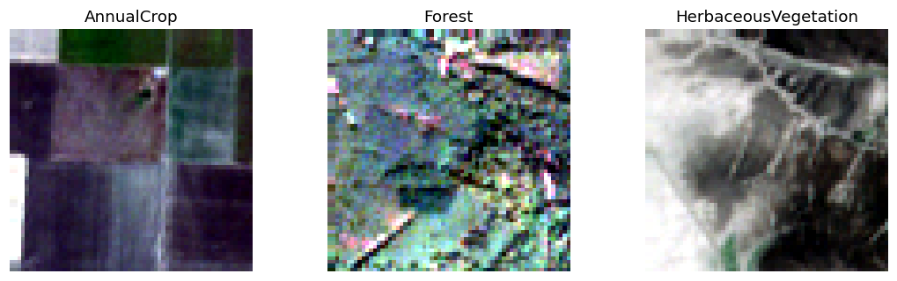
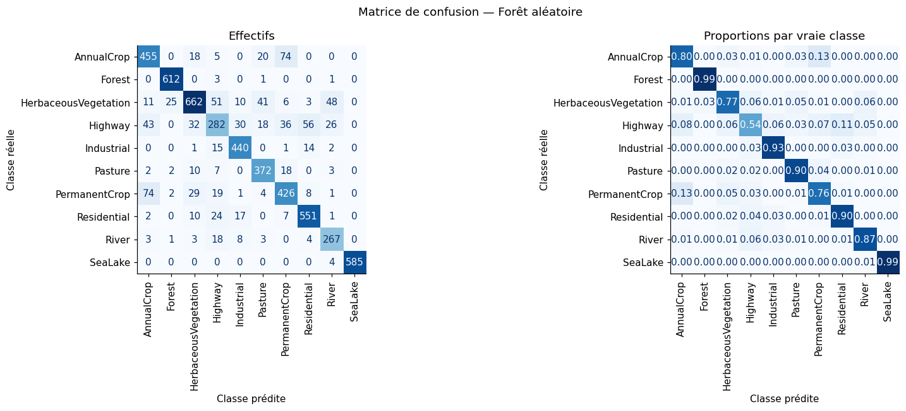

<h1 align="center">EuroSAT<br>Multispectral Land Cover Classification</h1>

<p align="center">
  <a href="https://github.com/lizbethtorresflores">Lizbeth Alexandra Torres Flores</a><br>
  Proyecto académico en grupo · Projet académique en groupe<br>
  Python · Sentinel-2 · Machine Learning · Random Forest
</p>

<p align="center">
  <a href="#resumen-en-español">Español</a> ·
  <a href="#résumé-en-français">Français</a> ·
  <a href="#resultados--résultats">Resultados / Résultats</a> ·
  <a href="docs/RESULTATS.md">Gráficos / Graphiques</a> ·
  <a href="docs/REFERENCES.md">Referencias / Références</a>
</p>

<p align="center">
  <a href="https://colab.research.google.com/github/lizbethtorresflores/eurosat-land-cover-classification/blob/main/projet_a_eurosat_g1_COMPLET_FR.ipynb">
    
  </a>
</p>

<p align="center">
  <br>
  <em>Ejemplos de imágenes Sentinel-2 del estudio, con contraste ajustado para su visualización.<br>
  Exemples d’images Sentinel-2 de l’étude, avec contraste ajusté pour l’affichage.</em>
</p>

## Resumen en español

Este proyecto clasifica imágenes satelitales multiespectrales de **EuroSAT** en **diez clases de cobertura del suelo**. Cada imagen de 64 × 64 píxeles contiene 13 bandas espectrales. Se extraen la media y la desviación estándar de cada banda, obteniendo **26 características por imagen**.

El método utiliza una pipeline **StandardScaler + Random Forest de 200 árboles**. La evaluación separa los datos por bloques geográficos de 50 km y mantiene al menos 2 km entre los centros de imágenes de conjuntos distintos, para reducir la proximidad espacial entre entrenamiento, validación y test.

El notebook incluye exploración de datos, comprobación de duplicados, selección de hiperparámetros, normalización, evaluación con intervalos de confianza, importancia de variables y análisis de errores. El código y el informe principal están en francés. El trabajo se realizó en grupo a partir de un notebook docente; las fuentes se describen en [Referencias](docs/REFERENCES.md).

## Résumé en français

Ce projet classe des images satellitaires multispectrales **EuroSAT** en **dix classes d’occupation du sol**. Chaque patch de 64 × 64 pixels comporte 13 bandes. La moyenne et l’écart-type de chaque bande forment **26 caractéristiques**, utilisées par une pipeline **StandardScaler + forêt aléatoire de 200 arbres**.

Le protocole sépare des blocs géographiques de 50 km et impose une distance minimale de 2 km entre les centres des patches d’ensembles différents. Le notebook présente l’exploration des données, les contrôles de doublons, la sélection sur validation, les intervalles de confiance, les importances par permutation et l’analyse des erreurs. Ce travail académique a été réalisé en groupe à partir d’un notebook de cours.

## Método / Méthode

| Étape | Méthode |
| --- | --- |
| Données | 27 000 patches multispectraux EuroSAT, 64 × 64 pixels, 13 bandes |
| Représentation | 13 moyennes + 13 écarts-types par patch |
| Séparation | Blocs de 50 km ; distance minimale de 2 km entre centres |
| Prétraitement | StandardScaler ajusté uniquement sur les données d’apprentissage utilisées à chaque étape |
| Modèle | RandomForestClassifier : 200 arbres, `max_features="sqrt"`, `random_state=0` |
| Sélection | Quatre configurations sur validation ; profondeur non limitée et `min_samples_leaf=1` retenus |
| Ajustement final | Apprentissage + validation, soit 21 139 patches |
| Évaluation | Accuracy, F1 macro, résultats par classe, matrice de confusion ; 1 000 rééchantillonnages de blocs pour les intervalles |

Les dix classes sont : AnnualCrop, Forest, HerbaceousVegetation, Highway, Industrial, Pasture, PermanentCrop, Residential, River et SeaLake.

## Resultados / Résultats

Les chiffres ci-dessous proviennent des sorties enregistrées dans le notebook et des [exports CSV](resultats_eurosat_normalise/).

| Indicateur | Résultat |
| --- | ---: |
| Patches d’apprentissage | 16 995 |
| Patches de validation | 4 144 |
| Patches de test | 5 528 |
| Patches exclus par la zone tampon | 333 |
| **Accuracy sur test** | **84,15 %** |
| **F1 macro sur test** | **0,836** |
| Intervalle à 95 % de l’accuracy | [79,82 % ; 87,72 %] |
| Intervalle à 95 % du F1 macro | [0,786 ; 0,865] |
| Accuracy de la référence majoritaire sur test | 10,35 % |

<p align="center">
  
</p>

**SeaLake** et **Forest** obtiennent les meilleurs F1 : 0,997 et 0,972. **Highway** est la classe la plus difficile, avec un F1 de 0,596. Les confusions les plus fréquentes sont AnnualCrop → PermanentCrop et PermanentCrop → AnnualCrop, avec 74 patches dans chaque sens.

Consulter la [galerie des résultats](docs/RESULTATS.md), les [performances par classe](resultats_eurosat_normalise/performances_par_classe.csv) et la [conclusion détaillée](resultats_eurosat_normalise/conclusion.md).

## Ejecución / Exécution

**Google Colab** est l’environnement conseillé : certaines cellules de préparation utilisent des commandes Linux. Le notebook conserve ses sorties et peut être consulté directement sur GitHub sans relancer l’entraînement.

1. Cliquer sur **Open in Colab** en haut de cette page.
2. Exécuter les cellules dans leur ordre, depuis le début.
3. Prévoir le téléchargement de l’archive EuroSAT multispectrale, d’environ **2 Go**, puis son extraction.
4. Consulter les graphiques et les tableaux. Les exports sont écrits dans `resultats_eurosat_normalise/`.

Les bibliothèques sont listées dans [requirements.txt](requirements.txt). Pour préparer un environnement Python compatible :

```bash
pip install -r requirements.txt
```

L’exécution de référence enregistrée utilise Python 3.12.2 et scikit-learn 1.8.0. Les temps de calcul dépendent de l’environnement.

## Estructura / Organisation

```text
.
├── projet_a_eurosat_g1_COMPLET_FR.ipynb   # Code, explications et sorties
├── requirements.txt                     # Dépendances Python
├── resultats_eurosat_normalise/          # Métriques, prédictions, normalisation
├── docs/
│   ├── RESULTATS.md                     # Galerie des figures du notebook
│   ├── REFERENCES.md                    # Sources et contexte académique
│   └── images/                          # Figures originales exportées
└── .gitignore                           # Exclusion du dataset et des fichiers locaux
```

## Alcance y límites / Portée et limites

**ES.** Se predice una etiqueta por imagen completa. Las 26 estadísticas pierden la geometría de los objetos, lo que puede dificultar la identificación de carreteras o superficies mixtas. La separación espacial reduce algunos riesgos de evaluación optimista, pero los resultados no garantizan el mismo rendimiento en otras regiones o fechas. Solo se estudió una familia de modelos y se utilizó validación reservada, sin validación cruzada. El mismo test ya se había consultado en una evaluación anterior; la reevaluación con normalización no constituye una validación independiente ni demuestra por sí sola una mejora.

**FR.** La prédiction porte sur un patch entier. Les statistiques perdent la disposition spatiale des pixels. La séparation géographique réduit certains risques sans garantir la généralisation à d’autres régions ou dates. Une seule famille de modèles est étudiée, avec une validation réservée. Le test a déjà été consulté lors d’une évaluation précédente ; la réévaluation avec normalisation ne constitue pas une validation indépendante et ne démontre pas à elle seule une amélioration.

Les images sources sont disponibles sur [EuroSAT multispectral — Zenodo](https://zenodo.org/records/7711810). Le dataset est téléchargé par le notebook ; il n’est pas stocké dans ce dépôt. Les figures présentées ici sont les sorties enregistrées du projet.
