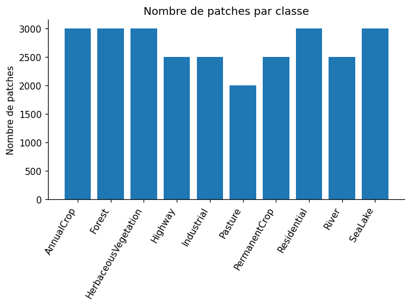
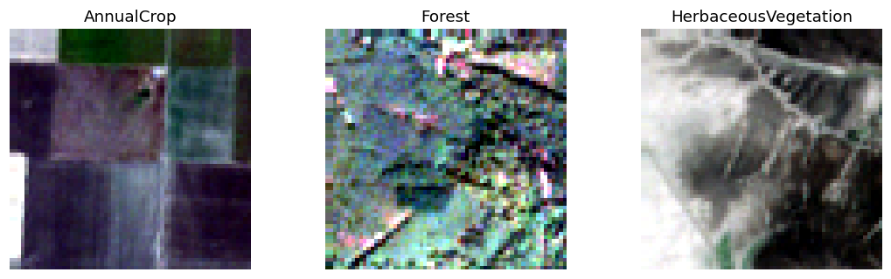
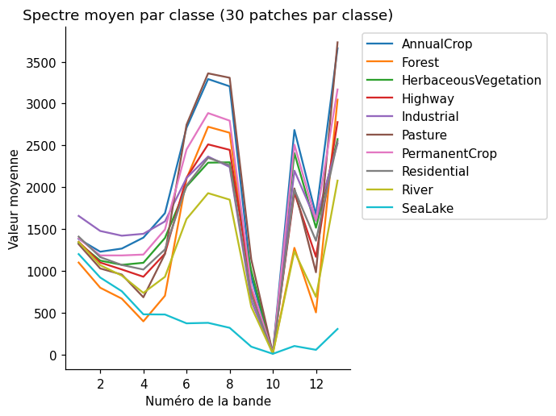
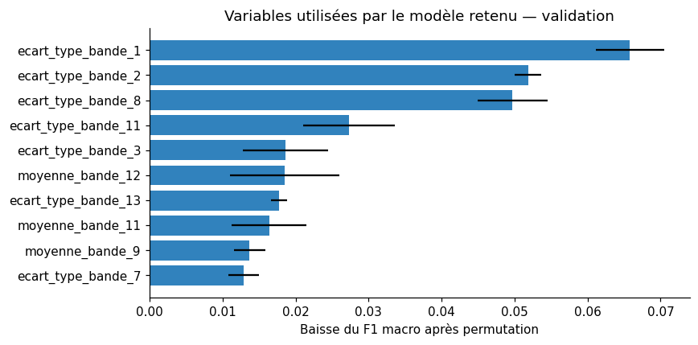
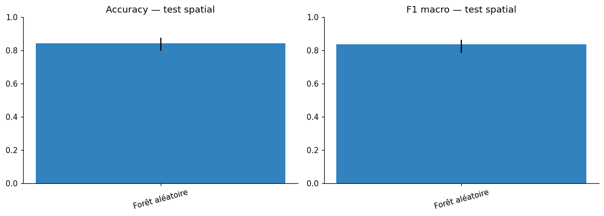
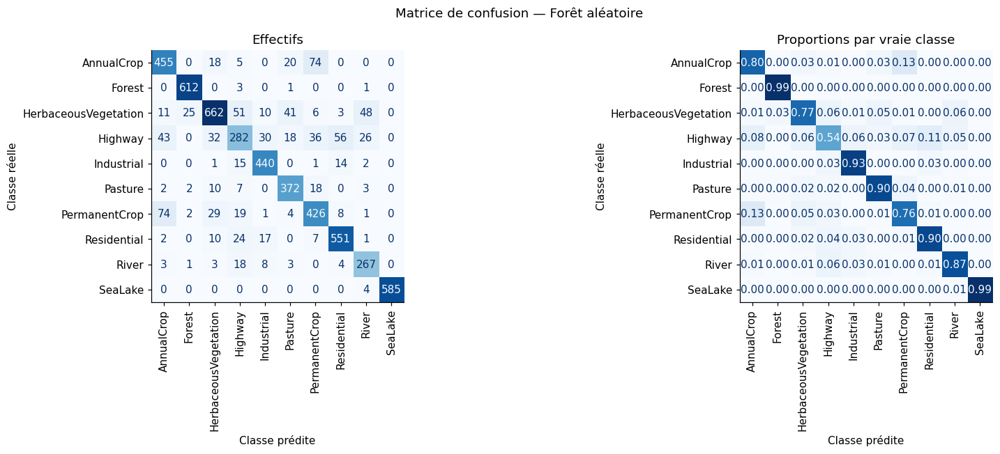
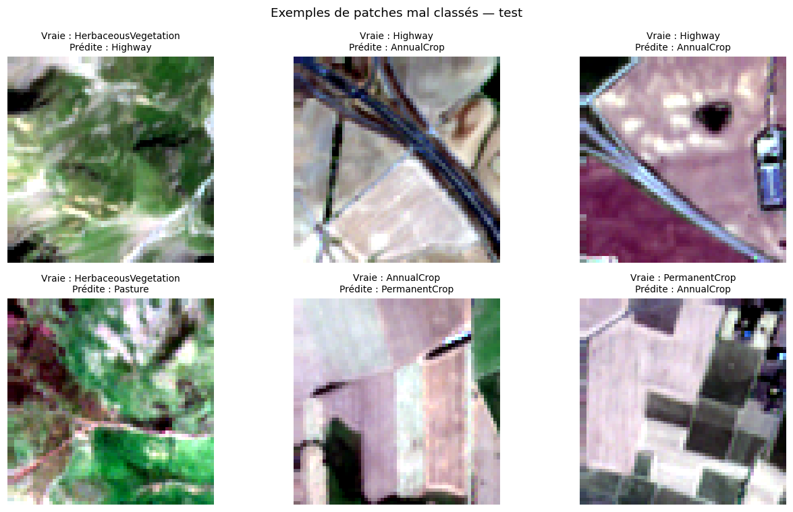

# Resultados visuales / Résultats visuels

Estas figuras se extrajeron de las salidas guardadas del [notebook principal](../projet_a_eurosat_g1_COMPLET_FR.ipynb). Son los gráficos originales del proyecto; no se volvió a entrenar el modelo para preparar este repositorio.

Ces figures sont extraites des sorties enregistrées du notebook. Les valeurs détaillées sont disponibles dans [les tableaux de résultats](../resultats_eurosat_normalise/).

## Répartition des classes

Les dix classes comportent entre 2 000 et 3 000 patches chacune avant la séparation spatiale.

## Exemples RGB

Composition RGB avec les bandes 4, 3 et 2 ; contraste ajusté pour l’affichage.

## Spectres moyens

Exploration sur 30 patches par classe. Une proximité spectrale suggère une difficulté possible, sans prouver une confusion du modèle.

## Importance des variables

Les importances sont calculées par permutation sur la validation, à travers la pipeline. Elles ne mesurent pas une importance causale des bandes.

## Performances et intervalles

Les intervalles à 95 % proviennent de 1 000 rééchantillonnages des blocs géographiques de test. Ils ne couvrent pas toutes les incertitudes d’apprentissage ou de généralisation.

## Matrice de confusion

Évaluation sur 5 528 patches de test ; paramètres sélectionnés sur la validation.

## Exemples d’erreurs

Exemples inspectés pour comprendre les limites de la représentation par statistiques de bandes. Les causes proposées restent des hypothèses.
